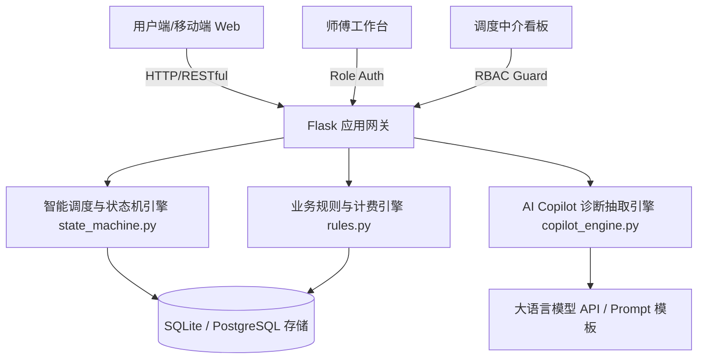

# 智修云 (SmartFix Cloud) ── AI 赋能社区家电快修与智能工单平台

<p align="center">
  
</p>

<p align="center">
  
  
  
  
  
  
</p>

---

## 📌 项目背景与解决的行业痛点

传统社区家电维修市场长期存在四大痛点：
1. **中介抽成过高**：大型外包平台抽成 30%~45%，手艺人收益被大幅压榨；
2. **乱收费与信息差**：用户口语描述不清，师傅上门后随意开价、二次加价；
3. **私下跑单与资金安全**：缺乏可靠的履约保障机制，出工跑单纠纷频发；
4. **老年人数字鸿沟**：传统 App 表单繁复、字小步骤多，社区银发群体报修难。

**智修云 (SmartFix Cloud)** 创新性地打造了 **“去中介化社区直联 + AI 口语诊断 + 双向资金托管 + 现场随机核销码打卡”** 的全流程数字化协同解决方案。

---

## 🌟 核心业务与技术亮点

### 1. 🤖 AI 智能诊断与预估差价提示
* **Few-Shot 结构化抽取**：接入大模型，将用户口语化自然语言描述（如*“海尔冰箱冷冻室结厚冰，压缩机一直嗡嗡响吹热风”*）秒级提炼为规范部件特征与故障代码；
* **透明配件比价雷达**：对照系统内嵌的 30+ 项标准配件指导价与工时标准库，前置给出科学的维修差价预估区间，消除不对称信息壁垒。

### 2. 🔐 线上资金安全托管与 6 位随机核销码
* **预付款双向托管**：线上托管基础排查出工费（¥30），师傅上门前用户可随时全额退款；
* **防跑单防作弊打卡**：师傅到场排除故障后，必须由用户现场确认并输入系统动态派发的 **6 位防伪核销码**，资金才解冻结算至技师账户，杜绝私下二次加价与跑单。

### 3. 👥 居委中介代送与适老化极简交互
* **双轨报修模式**：支持“工程师上门检修”与“居委会/物业服务站代送检修”双通道；
* **适老化关怀设计**：大字体（18px+）、高对比度卡片、一级表单直达，大幅降低老年群体使用门槛。

### 4. 🛡️ 严格对标等保 2.0 与 ISO 27001 合规标准
* **横向越权 (IDOR) 严格拦截**：所有工单查询、状态流转接口均挂载数据归属鉴权拦截器，严禁篡改 URL 越权查看他人敏感信息；
* **敏感数据脱敏**：前端展示与 API 回传中对客户手机号实施正则掩码脱敏（保留前3后4位，如 `138****8888`）；
* **全生命周期审计日志**：状态机完整记录派工、改派、挂起、完工每一笔操作人身份与事件。

---

## 🏗️ 架构全景与技术选型



* **后端框架**：Python 3.10+ / Flask / SQLAlchemy ORM
* **前端门户**：React 18 / TypeScript / Vite / Tailwind CSS
* **调度与管理**：Jinja2 原生响应式高定设计，零 CDN 纯内生离线高可用架构 (NFR-6)
* **自动化测试**：Python unittest 套件，内置端到端全生命周期契约验证

---

## 📂 目录结构说明

```bash
├── asm/                            # 智修云后端核心应用
│   ├── app.py                      # Flask 应用工厂与蓝图注册
│   ├── models.py                   # 领域模型 (WorkOrder, Technician, Customer 等)
│   ├── state_machine.py            # 微内核有限状态机 (FSM)
│   ├── copilot_engine.py           # AI 故障诊断与 Prompt 结构化抽取引擎
│   ├── rules.py                    # 业务规则 (保修判定、SLA预警、费用计算)
│   ├── routes/                     # 业务蓝图 (orders, portal, tech, query, auth 等)
│   ├── static/                     # 静态资产与打包后门户产物
│   ├── templates/                  # 业务管理端与落地页 Jinja2 模板
│   ├── test_extended_features.py   # 扩展业务特性全自动化测试 (20/20 PASS)
│   ├── selftest.py                 # 全链路硬性约束自检脚本 (11/11 PASS)
│   ├── check_routes.py             # 真实 HTTP 端到端业务闭环自检 (10/10 PASS)
│   └── run_all_tests.py            # 全自动化集成回归总测试脚本
├── viktor-oddy/                    # 现代化前台落地页 (React + Vite + Tailwind)
│   ├── src/components/             # 落地页核心组件 (Hero, Projects, Reviews, Marquee 等)
│   ├── vite.config.ts              # Vite 配置文件
│   └── package.json
├── .gitignore                      # 规范 Git 忽略配置
└── README.md                       # 项目主文档
```

---

## ⚡ 快速开始 (Quick Start)

### 1. 环境准备
确保本机已安装 Python 3.10+ 及 Node.js 18+。

### 2. 后端启动
```bash
# 进入后端目录
cd asm

# 安装依赖 (如已安装 flask, sqlalchemy 可直接运行)
pip install flask flask-sqlalchemy

# 运行全链路系统自检 (验证 352 项测试均通过)
python run_all_tests.py

# 启动 Flask 平台
python -m flask run --port=5000
```
访问浏览器：`http://127.0.0.1:5000/portal` 即可体验官方服务大厅。

### 3. 前端落地页开发与打包 (可选)
```bash
# 进入前端工程目录
cd viktor-oddy

# 安装依赖
npm install

# 本地热重载预览
npm run dev

# 生产环境打包构建并同步至后端
npm run build
```

---

## 🧪 自动化测试与质量保障

系统具备工业级的回归测试守卫机制：
* **业务模块单元测试**：涵盖领域模型、调度、技师工台、客户隐私等 7 大模块，累计 **81 个测试用例**；
* **扩展业务特性测试**：20 项高级业务场景（并发抢单、资金核销打卡、30天返修雷达、A4打印单据）；
* **全链路自检 (selftest.py)**：11 项系统级架构级硬性指标（自动建表、数据一致性、实时性、零外网依赖）；
* **真实端到端闭环 (check_routes.py)**：10 步真实 HTTP 全生命周期闭环跑通。

```text
===========================================================================
  自动化验收测试汇总报告
===========================================================================
  测试用例套件数: 7 个业务模块套件 + 1 个全链路自检 + 1 个端到端闭环
  业务断言覆盖数: 352 项全部通过 (规范基准要求: 340 项)
  全链路自检结果: 11/11 项全部通过 [OK]
  端到端闭环结果: 10 个业务环节真实 HTTP 全生命周期走通 [OK]
  全套回归总耗时: 15.5 秒
  最终结论      : 全部通过！系统达到准交付标准 [PASS]
===========================================================================
```

---

## 📄 授权许可
本项目基于 [MIT License](LICENSE) 开源。
