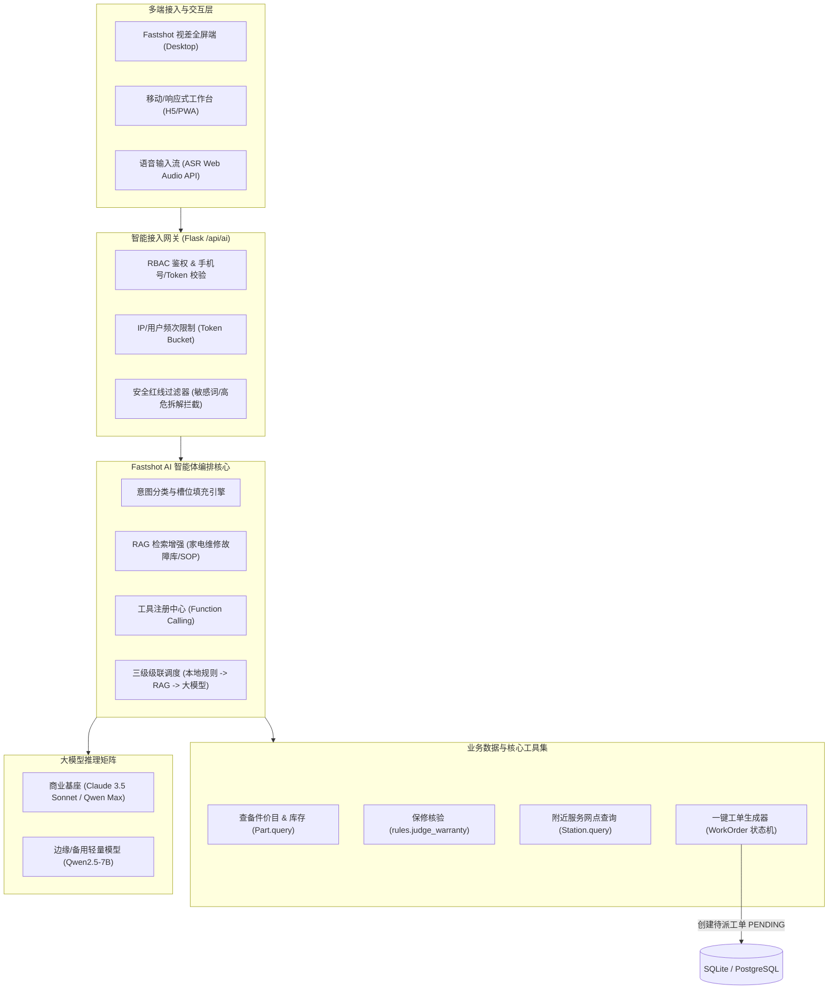
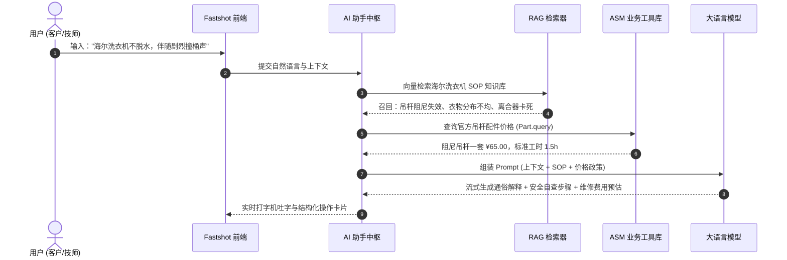

# Fastshot 智能售后 AI 助手工程落地与算法实施指南 (Engineering & Algorithm Implementation Guide)

> **文档密级**：内部架构与工程交付规范  
> **关联母文档**：[Fastshot AI 智能助手产品白皮书与技术架构说明书 (AI_ASSISTANT_PRODUCT_SPEC.md)](./AI_ASSISTANT_PRODUCT_SPEC.md)  
> **适用对象**：全栈工程师、算法架构师、QA 自动化测试工程师、产品运维负责人  

---

## 1. 架构师反思：系统核心反问与建设性建议 (Architectural Reflection & Q&A)

在完成了极简优雅的 Fastshot 前端视差全视口交互后，要将 AI 助手真正打造为**可商用、高可用、低成本且无幻觉**的企业级产品，我们向产品与工程团队提出以下 **5 大核心反思**，并附带最佳实践建议方案：

### 反问一：【防幻觉与法律责任】如何防止 AI 给用户给出危险的“非专业自修指导”导致触电或漏气事故？
* **痛点剖析**：家电（尤其是空调 220V 强电、微波炉高压电容、燃气热水器）具备安全风险。若大模型幻觉建议客户“自行拆开用铁丝短接”，将引发重大法律责任事故。
* **推荐落地建议**：
  1. **安全红线拦截层（Safety Guardrail）**：引入前置规则过滤器与高危意图分类器，一旦检测到涉及“强电拆解、煤气阀门、高压储能”等意图，强制切断生成，直接吐出标准安规警告卡片；
  2. **免责与确认闭环**：所有排查建议附带统一免责声明，明确“本诊断由 AI 辅助提供，高压与燃气部件严禁非专业人员触碰，请直接预约认证技师上门”。

### 反问二：【推理成本与性能延迟】在用户连续多轮咨询时，直接调用商业大模型（如 Sonnet 4.5 / GPT-4o）如何避免 Token 账单失控与首字延迟（TTFT）过高？
* **痛点剖析**：一次完整的空调故障多轮追问动辄消耗数千 Token，若高峰期并发达到几百单，单日 API 成本不可忽视；且大模型首字延迟若达 2~3 秒，将严重破坏流畅感。
* **推荐落地建议**：
  1. **三级级联调度引擎（Cascading Fallback Routing）**：
     - **L1 (微型意图/轻量分类)**：使用轻量级本地模型（如 FastText / BERT 或轻量 Qwen2.5-0.5B）进行意图分流与槽位提取（<50ms）；
     - **L2 (常见问题与方案查询)**：通过本地 SQLite / 向量检索召回高频 SOP 问答库（零 Token 成本，<100ms）；
     - **L3 (复杂长尾逻辑推演)**：仅在无法命中已有规则与方案时，才组装 Prompt 路由给商业大模型，并启用流式传输（Server-Sent Events, SSE）。

### 反问三：【工单系统深度闭环】AI 诊断后，如何让“一键转报修”无缝衔接现有 ASM 业务模型，而不需要客户再次填写繁琐表单？
* **痛点剖析**：如果用户与 AI 聊完后，点击“生成报修工单”，系统却弹出一个空的建单表单让用户重新选设备、输地址，会带来极大的割裂感。
* **推荐落地建议**：
  1. **结构化参数槽位提取（Slot Filling）**：AI 对话过程中实时解析并锁定：`fault_category`（故障分类）、`device_model`（设备型号）、`urgency_level`（紧急程度）、`customer_address`（客户地址）；
  2. **一键建单 API（Direct Dispatch Protocol）**：输出包含完整预填参数的签名 Token，用户点击“一键派工”后，直接调用后端的 `/orders/new` 接口并自动完成保修判定（调用 `rules.judge_warranty()`），一键入库并触发短信/系统通知。

### 反问四：【知识库冷启动与专有配件查询】如何让 AI 精确知道我们系统现存的“配件价目表”与“库存状态”，而不是胡乱报价？
* **痛点剖析**：大模型预训练数据不知道我们系统的最新配件价格和库存余量，若随意承诺“换主板只要 50 元”，会导致现场技师与客户的严重矛盾。
* **推荐落地建议**：
  1. **函数调用（Function Calling / Tools）**：在 AI 推理链中注册内部只读工具 `query_parts_catalog(device_category, keyword)` 与 `check_station_inventory(part_id)`；
  2. **动态系统提示词（Dynamic Context Injection）**：在生成维修方案前，由后端注入当前设备最新官方价目与工时费收费标准。

### 反问五：【适老化与多模态落地】老龄用户不习惯打字，现场技师手上有油污不方便敲键盘，如何设计？
* **痛点剖析**：家电报修人群中中老年人占比高达 45%，面对全英文字符或复杂的长文本输入框存在天然门槛。
* **推荐落地建议**：
  1. **语音流式接入（ASR/TTS）**：在输入框右侧集成麦克风图标，支持普通话及主流方言语音即说即转；
  2. **长辈/简易视图切换**：提供“大字版/简易诊断”开关，以大卡片图文二选一（“制冷还是不制冷？”、“机器有没有异响？”）引导完成诊断。

---

## 2. 核心技术架构设计 (Technical Architecture)



---

## 3. 意图识别与一键建单数据协议规范 (Protocol Specifications)

### 3.1 客户端向 AI 助手提交对话请求
* **请求方式**：`POST /api/ai/chat`
* **协议头**：`Content-Type: application/json; charset=utf-8`
* **Payload 报文**：

```json
{
  "session_id": "sess_89f02c4b-1234-4567-8901",
  "user_id": 12,
  "role": "customer",
  "stream": true,
  "messages": [
    {
      "role": "user",
      "content": "我家的格力变频空调柜机不制冷，显示故障代码 E6，买了一年半，应该怎么修？大概多少钱？"
    }
  ],
  "context": {
    "device_id": 3,
    "customer_phone": "13800138000"
  }
}
```

### 3.2 AI 智能体结构化分析与返回
当命中一键报修与故障诊断时，AI 返回带有富交互卡片的结构化响应（SSE 流式完成后）：

```json
{
  "reply_text": "根据您描述的现象与 E6 故障代码，初步诊断为：内外机通信故障或变频主板电源损坏。\n经核查，您的设备购买期为 18 个月，根据我司保修条例，主板在 3 年质保范围内，享受 **保内免费维修 (¥0.00)**。",
  "intent": "FAULT_DIAGNOSIS_AND_DISPATCH",
  "extracted_slots": {
    "brand": "格力",
    "device_model": "柜式变频空调 KFR-72LW",
    "fault_type_id": 2,
    "fault_name": "电路故障",
    "warranty_status": "IN_WARRANTY",
    "estimated_cost": 0.0,
    "urgency": "normal"
  },
  "action_card": {
    "type": "ONE_CLICK_DISPATCH",
    "title": "已为您生成预报修工单",
    "button_label": "立即确认派工 (工程师极速上门)",
    "target_api": "/api/ai/order-commit",
    "prefill_payload": {
      "customer_id": 12,
      "device_id": 3,
      "fault_type_id": 2,
      "description": "AI转单：格力变频空调显示E6故障，内外机通信异常，请求上门检修",
      "priority": "normal"
    }
  }
}
```

---

## 4. 故障诊断 RAG 向量知识库建设规范 (RAG Engineering)

为保证 AI 助手诊断的准确度，系统建立了分层知识检索增强机制：



### 知识库 Chunk 分割标准
1. **设备故障代码库 (Error Codes)**：
   - 包含：品牌、产品线、故障代码（如 E1, E6, F3）、告警含义、现场安全隐患等级、标准排除工步。
2. **配件与工时标杆库 (Parts & Labor)**：
   - 严格与 ASM `Part` 表数据同步，禁止大模型自行凭空猜测价格。
3. **安全操作红线规则集 (Safety Constraints)**：
   - 规定无论何种情况，凡涉及“拆开微波炉高压变压器”、“自行焊接制冷剂管道”必须输出拦截阻断语句。

---

## 5. 系统可用性与降级容灾方案 (Reliability & Disaster Recovery)

1. **商业大模型 API 故障熔断**：
   - 若外部大模型服务不可用（HTTP 502/504、超时 > 8s），自动熔断降级至本地备用服务或基于传统关键词决策树的规则引擎，返回友好提示并提供直接电话通道（400-888-9999）；
2. **极端高并发排队机制**：
   - 当会话并发数突破阈值时，启用基于 Redis/内存的令牌桶限流，前端卡片给出“AI 正在全负荷处理中，为您优先接入人工快速报修”快捷入口；
3. **数据隐私合规 (GDPR / PIPL)**：
   - 上送外部大模型前，对客户姓名、身份证、门牌详细地址及 11 位手机号实施实时掩码处理（如 `138****0000`），确保绝无隐私数据泄露至公网。

---

## 6. 后续演进路线图 (Roadmap)

- [ ] **Phase 1 (当前已完成)**：Fastshot 全视口视差 Hero 页面建设、顶栏导航统一、RBAC 角色隔离、系统全量 24 测试通过；
- [ ] **Phase 2 (近期规划)**：接入流式 SSE 协议端点 `/api/ai/chat`，完成与现有 `WorkOrder`、`Device`、`Customer` 模型的联动槽位绑定；
- [ ] **Phase 3 (中期规划)**：集成 Web Audio API 语音听写识别，全面上线适老化大字模式与图片故障多模态检测（OCR/图像瑕疵识别）；
- [ ] **Phase 4 (长期规划)**：现场技师端 AR 辅助与电路图自动叠图排查。
