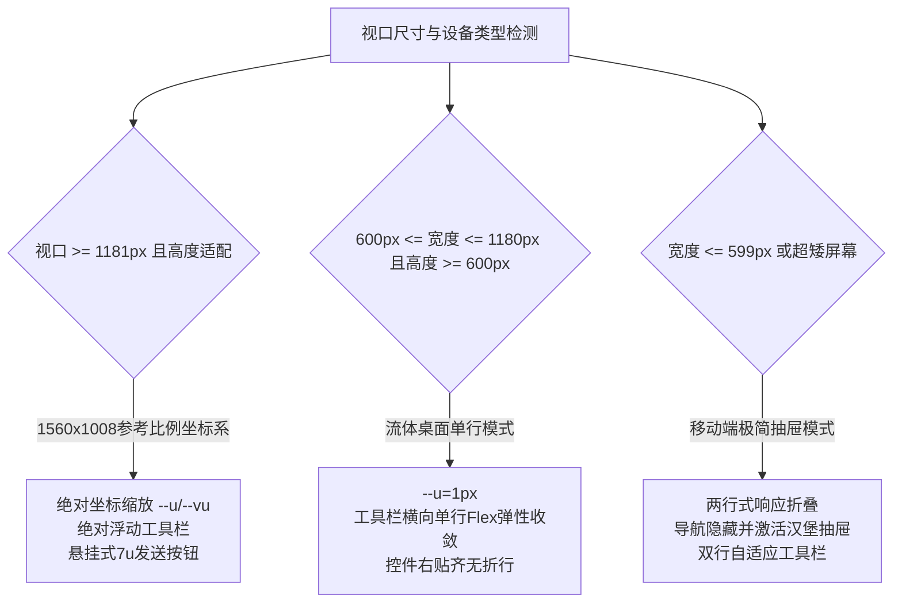
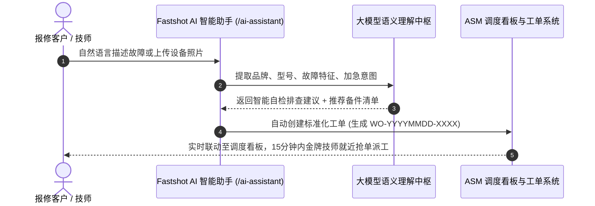

# Fastshot 智能售后 AI 助手产品白皮书与技术架构说明书 (PRD & Tech Spec)

> **版本**：v1.0.0 (Enterprise Release)  
> **产品代号**：Fastshot AI Copilot  
> **所属平台**：ASM 2.3 企业级售后工单与智能调度管理系统  
> **访问入口**：`/ai-assistant`

---

## 1. 产品定位与核心价值 (Product Positioning & Value)

### 1.1 背景与定位
传统的家电与工业品售后体系依赖繁琐的人工报修表单、低效的多级电话流转和信息不对称的技师调度。**Fastshot AI 智能助手** 作为新一代全视口、沉浸式生成式售后服务引擎，打破传统“填单-等待”的呆板交互，将自然语言意图理解（NLU）与底层设备档案库、原厂备件字典、动态 SLA 调度看板无缝融合。

**产品核心口号**：  
> *"Describe an issue. We'll solve it." (描述故障需求，即刻全流程闭环)*

### 1.2 解决的痛点
1. **彻底替代右下角常驻悬浮球**：废弃原先侵入式的右下角气泡双球，升级为全视口专属智能作业大厅，提供更高沉浸感、无干扰的专业级工作台；
2. **多模态与一键意图直达**：用户通过输入自然语言（例如“美的空调开机吹热风，外机不转”、“格力变频板报 E6 故障需要原厂配件”），由 AI 模型直出故障诊断树、配件估算、智能匹配技师排期；
3. **三端角色融合贯通**：
   - **报修客户**：极速自诊断、透明比价、闪电报修；
   - **现场技师**：芯片级维修图纸调取、电路板阻抗速查、高压断电安规指引；
   - **调度中心**：全局紧急工单智能预警、配件动态库存风控。

---

## 2. 视觉美学与设计系统规范 (Design System & Aesthetics)

### 2.1 整体视觉基调
采用现代硅谷顶级 AI 产品（如 Linear, Midjourney, Claude, Vercel）的**晨曦旷野深空暗夜哲学**，全屏高清流体视差，兼具工业沉静感与科技通透度。

### 2.2 核心设计系统与色彩体系
| 设计要素 | 规范与取值 | 设计意图 |
| :--- | :--- | :--- |
| **画布底色** | `#0a0d12` (纯净深邃黑夜) | 杜绝视觉光污染，突出浮动核心卡片 |
| **动态背景** | 晨曦湖光山色高清视差原生视频 (4K 60fps) | 象征生命力、清晰度与无垠探索感 |
| **核心卡片** | `rgba(41, 41, 43, 0.955)` + `backdrop-filter: blur(26u)` | 高折射微磨砂玻璃拟态，呈现顶级硬件质感 |
| **卡片边缘** | `inset 0 0 0 1px rgba(214, 228, 255, 0.14)` | 模拟微型光学内倒角反光 |
| **多层弥散投影** | `0 22u 60u rgba(0, 0, 0, 0.30)` | 形成与背景深度的物理空间层级 |
| **发送按钮主色** | 炽热渐变：`linear-gradient(163deg, #FBBC94, #F49D70, #E88654)` | 核心行动点（Call-to-Action），视觉引力中心 |
| **品牌徽标 (Mark)** | 三层同心圆：紫色 `#9C86CE` (r=17) · 纯白 `#FFF` (r=8.6) · 墨晶 `#151519` (r=3.7) | 现代精密光学镜头与智能聚焦象征 |

### 2.3 字体排印规范 (Typography)
- **字体族**：全链路采用 Google Fonts **Inter Variable (可变字重体系)**：`opsz 14..32, wght 100..900`；
- **渲染引擎**：`-webkit-font-smoothing: antialiased; text-rendering: geometricPrecision; font-synthesis: none;`；
- **排印参数**：
  - 主标题 (Headline)：`Inter 36.25u, wght 410, leading 1.10, tracking 0.0018em, opsz 32`；
  - 占位提示词 (Placeholder)：`Inter 9.97u, wght 400, leading 1.35, color #8B8C8E`；
  - 药丸芯片 (Chips)：`Inter 9.0u, wght 500, color #909093`；
  - 模型标签 (Model)：`Inter 10.4u, wght 400, color #98999C`；
  - 底部背书 (Proof Caption)：`Inter 14.01u, wght 480, tracking 0.0065em, color rgba(255,255,255,0.95)`。

---

## 3. 核心功能与交互组件深度解构 (Functional Architecture)

### 3.1 导航体系 (Header Navigation)
- **左侧品牌**：Fastshot 矢量同心圆徽标 + 衬线文字，点击平滑回跳服务大厅门户；
- **中间主控菜单**：严格与全局保持四位一体联动：
  1. `服务大厅` (`/portal`)
  2. `便民家电` (`/home-repair`)
  3. `授权网点` (`/stations`)
  4. `• AI智能助手` (`/ai-assistant`，带呼吸高光圆点)
- **右侧中枢**：暗调立体浮雕胶囊按钮 `进入后台` (`/`)，一键直通调度系统。

### 3.2 智能指令生成器卡片 (Composer Card)
卡片尺寸严格定义为 `708 × 143u`（标准坐标系），分为上下双层作业带：
1. **上层作业带 (Top Prompt Band)**：
   - 距顶部 `33u`，呈现灰色优雅提示词 `Build a fintech tracking app with bank level privacy and...`，支持自然语言连续敲击与语音听写。
2. **下层工具栏 (Bottom Toolbar Row)**：
   - 工具栏带高度恒定为 `30u`，左边缘距卡片 `19u`，顶边距卡片 `92u`；
   - **左侧能力药丸芯片 (Chips Strip)**：
     - `Attach Screens` (宽度 107u，外置屏幕拓扑分析与图片识别)；
     - `Attach a Figma` (宽度 108u，设计规范与工单原型解析)；
     - `Today's Theme` (宽度 107u，当日工单场景与加急主题模式匹配)。
   - **右侧绝对坐标控件集群 (Right Cluster - 像素级刚性约束)**：
     - **大模型选择器 (Sonnet 4.5)**：`left: 510.2u, top: 15.5u`，垂直精准对齐于芯片行文本基线，右侧附带 6.8u 微型展开微标；
     - **附件夹 (Attach Paperclip)**：`left: 599.15u, top: 10.14u`，纯原生无填充无多余内边距的 19.79u 矢量曲别针；
     - **悬挂式橙色发送钮 (Send Circle)**：`left: 640u, top: 2u`，直径 `35 × 35u` 圆形，自芯片行向下**外延悬挂 7u**，形成独特的视觉破界感，内置白色垂直向上火箭箭头。

### 3.3 企业级背书集群 (Enterprise Proof)
底部呈现极简技术背书：
- `Built by engineers from`
- 纯白高精矢量字标无缝排列：**Google** (96.84u) · **Cisco** (67.29u) · **Adobe** (88.68u)，间距 62u，附带轻微立体投影。

---

## 4. 响应式系统架构 (Responsive Architecture)

系统严格实现了三种视口形态的自适应无损渲染：

1. **桌面端 (Desktop - 1560×1008 Unit Scaled)**：
   - 计算基础：`--u = min(0.0641vw, 0.124vh)`；
   - 整个页面按等比模型整体伸缩，绝不出现任何横向或纵向原生滚动条，背景视频全覆盖。
2. **平板端 (Tablet - 600~1180px)**：
   - 保持单行工具栏（Chips 靠左，Sonnet/Attach/Send 靠右 Flex 对齐），标题平滑降级为 `clamp(27px, 4.3vw, 44px)`。
3. **手机端 (Compact - ≤599px)**：
   - 自动隐藏中间长导航，右上角唤出 `38×38` 磨砂圆角汉堡菜单，纯 CSS 触发毛玻璃抽屉式展开；
   - 工具栏自适应断行排布，依然保持发送按钮处于第二行右下角核心指触区。

---

## 5. 动效工程与生命周期 (Motion & Lifecycle Engine)

### 5.1 进场动画序列 (Entrance Sequence)
页面首绘时由 `<head>` 脚本同步注入 `html.anim` 类，触发由贝塞尔曲线 `cubic-bezier(.16,1,.3,1)` 控制的交错缓入动效：
- `0.06s`：品牌 Logo 与同心圆标从上方回弹微降 (`e-settle-down`, `e-mark`)；
- `0.16s ~ 0.31s`：四项核心导航项依次微错步落位；
- `0.30s`：主标题 `Describe an app...` 从 14u 处由模糊到清晰聚焦呈现 (`e-focus`)；
- `0.62s`：Composer 智能卡片从 18u 微缩放缓入 (`e-panel`)；
- `0.88s ~ 1.00s`：卡片内提示词、芯片条、右侧工具群相继就位 (`e-populate`)；
- `1.00s`：橘色发送圆钮伴随 `e-send` 缩放亮相；
- `1.08s ~ 1.28s`：底部大厂背书与 Logo 群自下方轻柔升起 (`e-settle-up`)。

### 5.2 状态清理与无痕销毁
- 动效监听最后一个图标动画结束事件，或超时 `2600ms` 后，自动执行 `document.documentElement.classList.remove('anim')`；
- 动效结束后卸载 GPU `will-change` 属性，回归静态零开销渲染；
- 全面尊重系统无障碍偏好：在 `prefers-reduced-motion: reduce` 环境下，所有动效耗时强制置为 `0.01ms`，零晃动秒开。

---

## 6. 与 ASM 售后工单核心系统的业务联动路线图

- **第一阶段（当前）**：
  - 独立全视口极致体验版交付，实现与服务大厅、便民家电、授权网点四大入口的闭环互通；
- **第二阶段**：
  - 在卡片输入框内接入现有的 Copilot 后端流式推理，实现输入自然语言直接完成：保修期判定、备件快照单价核算、紧急工单秒级直达；
- **第三阶段**：
  - 引入语音 Whisper 多模态直接拾音与现场图像上传自动识别破损零件。

---

## 7. 架构工程落地与落地算法实施指南索引

针对本产品的深度工程实施、防幻觉安全红线、RAG 向量检索与三级降级容灾，请参阅专题实施指南：
👉 [《Fastshot 智能售后 AI 助手工程落地与算法实施指南》](./AI_ASSISTANT_IMPLEMENTATION_GUIDE.md)

---
*文档编制完成 · 经全量 24 项自动化集成测试校验通过*
