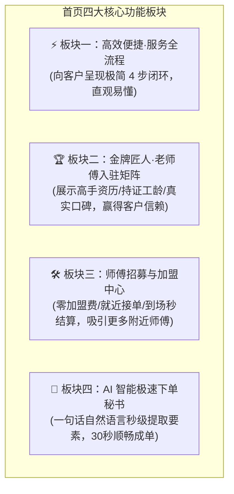

# 邻里家电快修服务平台 (Smart Appliance Marketplace) · 业务意图与需求演进文档 (intent.md)

> **版本**：3.1.0 (C2C Smart Repair Marketplace · Four Pillars Edition)  
> **更新时间**：2026-10-02  
> **指导思想**：坚持 KISS 原则与第一性原理，彻底剥离传统中心化售后与非标配件包袱，打造客户与维修师高效互信的双边快修撮合平台。

---

## 1. 核心战略定位与商业闭环重塑 (Strategic Pivot)

### 1.1 平台本质定位：轻资产 C2C 邻里家电快修撮合交易平台
- **去中心化双边市场**：剔除传统人工调度员与重资产配件仓库，直连**报修客户 (Customer)** 与 **附近自由/签约维修师 (Technician)**；
- **平台唯一收益命脉（防跳单核心）**：
  - 平台向客户收取标准化的 **¥30.00 基础排查上门费**，客户在下单时必须在线预付并由平台安全托管；
  - 严厉阻断线下私交与跳单：在师傅到达现场并验证客户 6 位动态核销码之前，资金全额冻结在平台托管账户中；师傅到场打卡核验成功后，扣除平台技术服务费（如 ¥5），净出工劳务款（¥25）秒级结算至师傅钱包。
- **业务边界彻底解耦（线下自由协商）**：
  - 机器深层故障检测、是否需要更换零配件、深度维修劳务费收多少，**完全交由客户与师傅在现场面对面透明、自愿协商解决**；
  - 平台不赚取非标配件差价，不承担深修纠纷，若客户对现场报价不满意可放弃维修（仅扣除 ¥30 基础排查费），彻底实现轻量化高速运转。

### 1.2 为什么必须“先确定维修产品，再挑选附近师傅”？
- 传统“附近师傅名册”脱离了具体故障场景，盲目给客户列出师傅没有决策依据（修空调的电工无法修微波炉，修油烟机的未必懂变频主板）；
- **正确且高效的业务链路**：
  1. 客户通过 AI 自然语言或一键点选**确定待修产品与故障**；
  2. 系统根据【电器类型擅长标签】+【LBS 物理距离】毫秒级筛选出周边 3-5 公里最匹配的在线老师傅；
  3. 客户直观比对师傅资历、距离与好评，自主选定心仪师傅（或选择一键全域广播）；
  4. 锁定师傅并在线预付 ¥30 上门费，进入极速履约。

---

## 2. 首页 / 开始界面四大核心板块设计白皮书

为了在首屏瞬间建立信任、促成下单并做大师傅供给池，开始界面严格由以下**四大核心功能板块**构成：

### 2.1 板块一：【⚡ 高效便捷 · 平台服务全流程指引】
- **业务目的**：直观向客户展示平台如何运作，打消“会不会被坑、上门费是什么、怎么修”的心理疑虑；
- **全流程四步闭环**：
  1. **AI 一句话报修**：输入或语音说明电器故障，AI 秒级提炼成单；
  2. **精准匹配附近师傅**：选定电器类型后，系统自动基于品类与距离展示附近在线老师傅，支持自主点选或全域抢单；
  3. **线上预付托管上门费**：¥30 基础排查费平台安全托管，未到场随时全额退款；
  4. **现场打卡与自由议价**：师傅到场出示 6 位核销码打卡；后续机器维修方案与配件费现场面对面自愿协商，不修无额外费用。

### 2.2 板块二：【🏆 老师傅入驻 · 金牌匠人与高信赖背书】
- **业务目的**：家电维修属于“入户服务”，客户最担心遇到二把刀或不诚信人员。通过展示平台严选的高手老师傅，建立坚不可摧的安全感；
- **核心展示要素**：
  - **高手资历沉淀**：展示真实入驻师傅档案（如：*李师傅 · 12年制冷专修持证工*、*王师傅 · 前品牌官方高级售后总监*）；
  - **擅长领域标签**：❄️ 空调高压检漏、🌀 滚筒洗衣机阻尼平衡、🧊 冰箱管路微漏焊接；
  - **信用与口碑数据**：已服务 1,200+ 邻里家庭、好评率 99.6%、持证电工与无犯罪实名背书；
  - **邻里真实反馈**：精选用户评价（*“师傅带着测压表15分钟上门，换了电容立刻吹冷风，做事利落价格公道！”*）。

### 2.3 板块三：【🛠️ 师傅招募加盟 · 供给端生态赋能】
- **业务目的**：双边平台的核心是供给密度。此板块专门面向社会维修工、水电工、制冷技师，持续做大附近师傅供给池；
- **核心权益宣导**：
  - **零加盟费、零押金**：真正免费入驻，拒绝割韭菜；
  - **家门口就近抢单**：根据常驻位置接 3-5 公里订单，通勤成本低，一天多接 3 单；
  - **出工费到场打卡秒到账**：上门打卡后平台扣除微薄技术佣金，净出工费 ¥25 秒到钱包余额，随时提现；
  - **线下维修费 100% 归师傅**：现场与客户协商达成的深度维修款和配件费全部归师傅所有，平台不抽成；
  - **一键快捷入驻通道**：1分钟勾选技能品类与常驻商圈，立刻开工听单。

### 2.4 板块四：【🤖 AI 智能极速下单秘书】
- **业务目的**：彻底颠覆传统繁重表单，让老年人、租房青年都能无障碍快速报修；
- **核心交互**：
  - 极简输入框（支持输入或语音粘贴）：*“我家美的变频空调开了有异味而且不吹冷风，明天周六上午10点师傅能来看看吗，我在海淀区中关村南大街1号院3号楼201”*；
  - **毫秒级语义提炼**：瞬间自动提取【品类：空调】、【品牌型号：美的变频空调】、【故障表象：异味且不吹冷风】、【预约时间：周六 10:00】、【门牌地址：海淀区中关村南大街1号院3号楼201】；
  - **无缝衔接选师傅**：识别到“空调”后，立即顺畅带出附近空调专修师傅卡片，实现 30 秒从需求到支付。

---

## 3. 用户旅程故事与双边闭环 (User Stories)

### 3.1 客户故事 (US-CUSTOMER)
- **US-CUST-1 (极速感知与建单)**：用户进入首页，看到清晰的 4 步流程与老师傅信赖卡片，直接在 AI 输入框粘贴一句话，系统立即自动填好洗衣机故障单；
- **US-CUST-2 (根据产品挑附近师傅)**：系统识别出“洗衣机”后，列表列出附近 1.2km 的王师傅（10年洗衣机专修，4.98★）与附近 1.8km 的张师傅。用户选定王师傅并线上预付 ¥30 上门费；
- **US-CUST-3 (现场核销与自愿协商)**：王师傅准时到达，客户出示手机上的 6 位核销码。王师傅打卡后现场排查，发现是硬币卡住了排水电机，现场报价 ¥50。客户认可并当场修好，线下扫码付给王师傅 ¥50。

### 3.2 维修师故事 (US-TECHNICIAN)
- **US-TECH-1 (吸引入驻)**：一名拥有多年空调经验的师傅浏览首页，被“零押金、就近接单、打卡秒结”吸引，点击一分钟登记技能并开工；
- **US-TECH-2 (邻里就近接单)**：手机弹出附近 900 米客户预约明天空调排查的订单，已被指定或抢单成功；
- **US-TECH-3 (打卡收益有保障)**：上门打卡输入核销码，¥25 净上门费秒到账，现场通过专业技术与客户线下协商修好机器，获得充分尊重与报酬。
