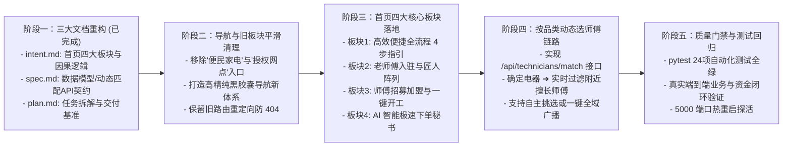

# 邻里家电快修服务平台 · 工程实施与迭代计划 (plan.md)

> **迭代版本**：v3.1.0 (C2C Smart Repair Marketplace · Four Pillars Edition)  
> **更新时间**：2026-10-02  
> **指导思想**：严格践行 **Plan ➔ Design ➔ Build ➔ Test ➔ Deploy ➔ Maintain** 闭环，贯彻第一性原理与轻资产双边撮合架构。

---

## 1. 3.1.0 版本实施阶段分解矩阵 (Implementation Matrix)

---

## 2. 详细任务拆解与进度清单 (Detailed Task Breakdown)

### 阶段一：三大文档固化 (100% 已完成)
- [x] **Task 1.1**：重写 [`intent.md`](file:///c:/Users/kd317/Desktop/毕业设计/intent.md)，明确首页四大板块意图、为什么不能单独设静态师傅页、品类驱动挑师傅因果逻辑及轻资产撮合定位；
- [x] **Task 1.2**：重写 [`spec.md`](file:///c:/Users/kd317/Desktop/毕业设计/spec.md)，定义四大板块组件契约、动态匹配接口 `/api/technicians/match`、线上预付托管协议与核销状态机；
- [x] **Task 1.3**：重写 [`plan.md`](file:///c:/Users/kd317/Desktop/毕业设计/plan.md)，建立清晰的五阶段工程迭代计划。

### 阶段二：清理废弃板块与顶栏重塑 (待执行)
- [ ] **Task 2.1**：从全局导航模板（`base.html`、`portal.html`）中安全剥离“便民家电”与“授权网点”入口；
- [ ] **Task 2.2**：优化顶栏公共入口架构为：【🏛️ 服务大厅】+【🛠️ 师傅入驻】+【🤖 AI智能助手】；
- [ ] **Task 2.3**：配置 `/home-repair` 与 `/stations` 优雅 302 重定向至服务大厅，确保旧外链不报错。

### 阶段三：服务大厅四大核心板块全面装配 (待执行)
- [ ] **Task 3.1**：装配【板块 1：⚡ 高效便捷全流程】：极简 4 步卡片（AI一句话报修 ➔ 附近挑师傅 ➔ 线上预付¥30 ➔ 到场核销自愿修）；
- [ ] **Task 3.2**：装配【板块 2：🏆 老师傅入驻·金牌匠人阵列】：展示持证高级工、10年+工龄、擅长品类徽章、99.8%好评率与真实邻里口碑；
- [ ] **Task 3.3**：装配【板块 3：🛠️ 师傅招募加盟】：零加盟费、家门口接单、打卡秒结出工费宣导，并连接一键入驻；
- [ ] **Task 3.4**：装配【板块 4：🤖 AI 极速下单秘书】：首屏大输入框与快捷示例，一句话 0.2 秒解析成单。

### 阶段四：确定家电品类后的动态挑师傅闭环 (待执行)
- [ ] **Task 4.1**：在后端实现 `GET /api/technicians/match` 接口，根据品类与距离动态筛选在线师傅；
- [ ] **Task 4.2**：在 `order_new.html` 建单向导中落地：当识别或选择具体电器（如“空调”）后，立刻呈现附近最匹配的 2~3 位老师傅卡片（包含距离、星级、持证工龄）供客户自主选择；
- [ ] **Task 4.3**：提供“⚡ 一键全域广播”备选项，兼顾个性挑选与极致速度。

### 阶段五：自动化测试回归与端到端验证 (待执行)
- [ ] **Task 5.1**：运行 `pytest -v` 确保现有 24 项测试保持 100% 绿灯；
- [ ] **Task 5.2**：验证后台 Flask 服务自动热重载生效，接口返回 HTTP 200。

---

## 3. 质量门禁检查准则 (Quality Gates)

| 门禁关卡 | 检查项目 | 合格验收标准 |
| :--- | :--- | :--- |
| **Gate 1: Intent & Spec** | 三大文档对齐四大板块与品类匹配逻辑 | 逻辑严密、无自相矛盾 |
| **Gate 2: Navigation** | 导航清理与旧外链兼容 | 无死链、无404，胶囊顶栏精致统一 |
| **Gate 3: Homepage** | 首页四大板块完整展现 | 全流程、老师傅、招募、AI秘书四位一体 |
| **Gate 4: Dynamic Match** | 确定产品后挑师傅链路完整 | 输入品类能实时计算匹配师傅并供勾选 |
| **Gate 5: Automated Tests** | 全量 pytest 回归测试 | **24 项测试 100% PASS** |
