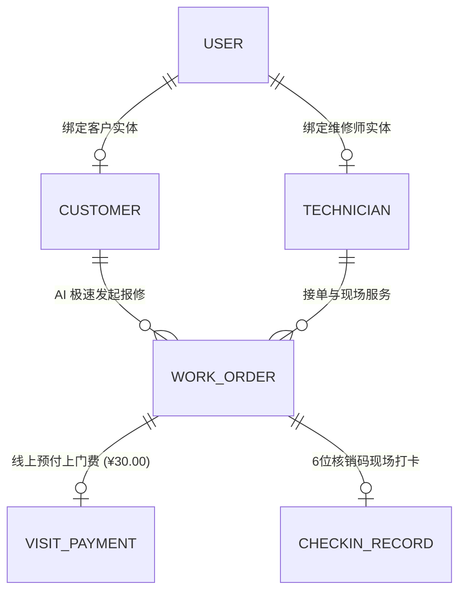
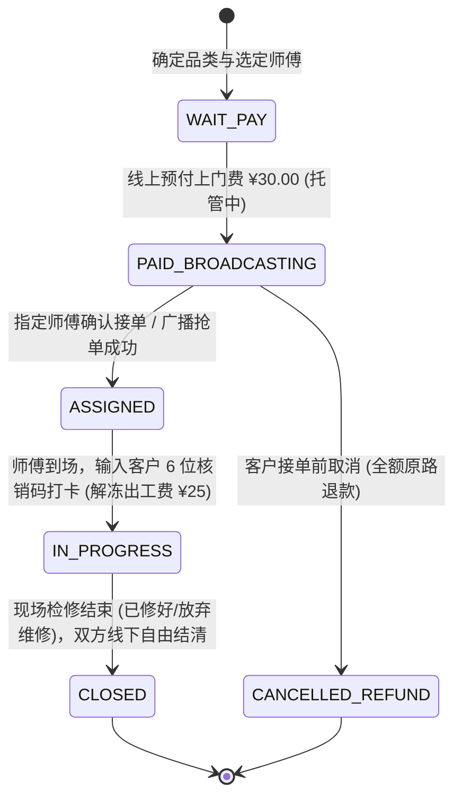

# 邻里家电快修服务平台 · 系统规格与设计契约 (spec.md)

> **版本**：3.1.0 (C2C Smart Repair Marketplace · Four Pillars & Dynamic Match Edition)  
> **更新时间**：2026-10-02  
> **文档定位**：规定 3.1 版本的全量数据模型 Schema、首页四大板块组件契约、动态按品类与距离筛选师傅接口契约、线上上门费托管与核销状态机。

---

## 1. 领域数据模型 Schema (3.1.0 C2C Marketplace)



### 1.1 核心数据表与字段契约

#### 1. 维修师实体表 (`technicians`)
| 字段名 | 类型 | 约束 | 业务语义与默认值 |
| :--- | :--- | :--- | :--- |
| `id` | INTEGER | PK | 维修工程师唯一标识 |
| `name` | VARCHAR(64) | NOT NULL | 师傅姓名 / 称呼（如“李师傅”） |
| `phone` | VARCHAR(20) | NOT NULL, INDEX | 联系手机号 |
| `cert_title` | VARCHAR(100) | DEFAULT '持证高级维修工' | 专业资质头衔（如“12年制冷专修持证工”） |
| `skill_tags` | VARCHAR(256) | DEFAULT '空调,洗衣机,冰箱' | 擅长家电品类（逗号分割，用于精准匹配） |
| `service_address` | VARCHAR(200) | DEFAULT '城市中心商圈' | 常驻服务商圈（计算邻里距离基准点） |
| `current_lat` / `current_lng` | FLOAT | NULL | 实时或常驻 LBS 经纬度 |
| `service_radius_km` | FLOAT | DEFAULT 5.0 | 最大接单服务半径（公里） |
| `balance` | FLOAT | DEFAULT 0.0 | 电子钱包累计可提现收益余额 |
| `is_online` | BOOLEAN | DEFAULT 1 | 听单状态（1: 接单中, 0: 休息中） |
| `rating_score` | FLOAT | DEFAULT 4.96 | 综合好评星级（满分 5.0） |
| `completed_orders_count` | INTEGER | DEFAULT 128 | 累计完成出工订单数 |

#### 2. 工单实体表 (`work_orders`)
| 字段名 | 类型 | 约束 | 业务语义与默认值 |
| :--- | :--- | :--- | :--- |
| `id` | INTEGER | PK | 工单主键 |
| `order_no` | VARCHAR(24) | UNIQUE, INDEX | 唯一业务工单号（如 `WO-20261002-0001`） |
| `customer_id` | INTEGER | FK(customers.id) | 归属客户 |
| `device_id` | INTEGER | FK(devices.id) | 关联设备档案 |
| `technician_id` | INTEGER | FK(technicians.id), NULL | 接单责任师傅（NULL 表示待抢单池） |
| `category` | VARCHAR(50) | NULL | 电器类型（AI 提取：空调、洗衣机、冰箱等） |
| `description` | VARCHAR(500) | NOT NULL | 故障现象描述 |
| `status` | VARCHAR(20) | NOT NULL, DEFAULT 'PENDING' | 业务状态机状态 |
| `visit_fee` | FLOAT | DEFAULT 30.00 | 平台标准基础排查上门费 |
| `platform_commission` | FLOAT | DEFAULT 5.00 | 平台技术撮合服务费 |
| `pay_status` | VARCHAR(20) | DEFAULT 'PAID' | 上门费支付状态 (`UNPAID`/`PAID`/`SETTLED`/`REFUNDED`) |
| `checkin_code` | VARCHAR(6) | NULL | 现场 6 位大写动态核销码 |
| `checkin_at` | DATETIME | NULL | 师傅现场核销打卡时间 |
| `offline_status` | VARCHAR(30) | NULL | 线下自愿协商结果 (`FIXED_OFFLINE` / `ABORTED_OFFLINE`) |

---

## 2. 首页四大核心板块组件规范 (Four Pillars UI Contract)

### 2.1 板块一：【⚡ 高效便捷 · 服务全流程】(`.process-stepper-grid`)
- **展示容器**：响应式 4 步卡片流（Desktop 4 列，Mobile 2×2 堆叠）；
- **4 步内容契约**：
  1. `Step 1`：💬 **AI 一句话报修** —— 粘贴描述，30 秒自动提炼要素；
  2. `Step 2`：📍 **智能挑附近师傅** —— 确定产品，匹配 3-5km 在线老师傅；
  3. `Step 3`：🛡️ **线上预付 ¥30 上门费** —— 平台全程安全资金托管；
  4. `Step 4`：🔑 **到场核销自愿修** —— 凭 6 位码打卡，线下自愿透明议价。

### 2.2 板块二：【🏆 老师傅入驻 · 金牌匠人阵列】(`.master-showcase-grid`)
- **展示容器**：3~4 张高手师傅卡片阵列；
- **每张师傅卡片字段**：
  - 师傅姓名、持证头衔徽章（如“持证高级电工”、“12年空调专修”）；
  - 擅长家电类型 Chip（如 `[❄️ 空调高压检漏]`、`[🌀 变频主板修复]`）；
  - 核心信用指标：★ 4.98 分 · 服务 1,400+ 家庭 · 准时率 99.8%；
  - 邻里真实口碑评价气泡。

### 2.3 板块三：【🛠️ 师傅招募加盟中心】(`.tech-recruit-banner`)
- **展示容器**：深色高光宽幅宣传卡片，强号召力设计；
- **核心数据与承诺**：
  - 零加盟费 · 家门口接单 · 出工费打卡秒到账 · 线下维修款 100% 归师傅；
  - 配备“立即申请入驻 (1分钟开工)”主行动按钮，点击直达师傅注册与画像建档。

### 2.4 板块四：【🤖 AI 极速下单秘书】(`.ai-copilot-input-box`)
- **交互规范**：
  - 首屏居中/置顶的一体化快速输入框，内置麦克风与发送图标；
  - 快捷示例 Chips：`[空调只吹风不制冷]`、`[洗衣机脱水晃动异响]`、`[冰箱不结冰漏水]`；
  - 点击或回车立即异步调用 `/api/copilot/extract-order`，并在 0.2 秒内自动填好并平滑呼起选师傅与支付面板。

---

## 3. 动态选师傅与撮合 API 契约

### 3.1 接口路径：`GET /api/technicians/match`
- **业务场景**：用户确定维修电器类型后，系统实时计算匹配的附近师傅；
- **请求参数**：
  | 参数名 | 类型 | 必填 | 示例值 | 说明 |
  | :--- | :--- | :--- | :--- | :--- |
  | `category` | STRING | 是 | `空调` | 待修家电品类 |
  | `lat` | FLOAT | 否 | `39.9042` | 客户地址纬度（未传时默认商圈基准） |
  | `lng` | FLOAT | 否 | `116.4074` | 客户地址经度 |
- **响应示例 (JSON)**：
  ```json
  {
    "status": "success",
    "category": "空调",
    "matched_count": 3,
    "masters": [
      {
        "id": 1,
        "name": "李师傅",
        "cert_title": "持证高级制冷维修工 (12年工龄)",
        "skills": ["空调", "冰箱"],
        "distance_km": 0.8,
        "estimated_arrival_min": 15,
        "rating_score": 4.98,
        "completed_orders": 1420,
        "is_recommended": true
      },
      {
        "id": 2,
        "name": "张师傅",
        "cert_title": "官方品牌认证金牌工程师",
        "skills": ["空调", "洗衣机"],
        "distance_km": 1.5,
        "estimated_arrival_min": 25,
        "rating_score": 4.95,
        "completed_orders": 890,
        "is_recommended": false
      }
    ],
    "broadcast_option": {
      "label": "⚡ 全域极速广播抢单 (向附近所有匹配师傅广播，最快者接单)",
      "estimated_response_sec": 30
    }
  }
  ```

---

## 4. 核心状态机规范 (State Machine 3.1)


